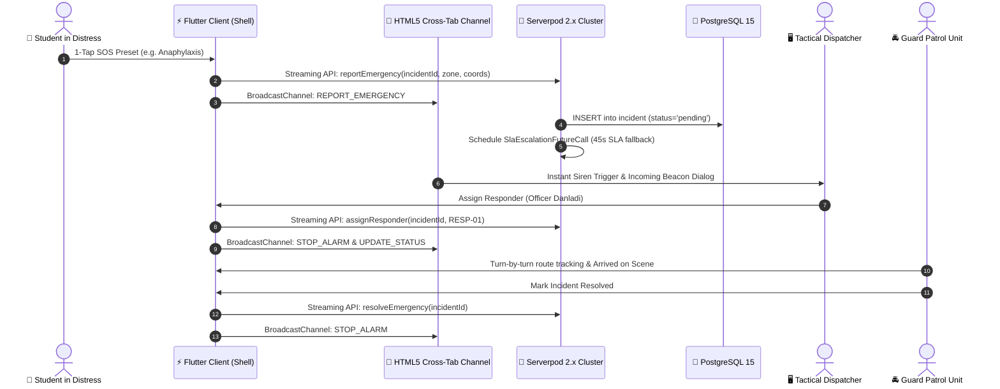

# 🚨 CampusRescue — Intelligent Campus Emergency Dispatch & Telemetry Platform

[](https://flutter.dev)
[](https://serverpod.dev)
[](https://www.postgresql.org)
[](file:///test/widget_test.dart)
[](LICENSE)

> **Zero-latency emergency dispatch, high-frequency GPS responder telemetry, and zero-typing student SOS beacon system built for high-stress university campus environments.**

---

## 🌐 Live Interactive Cloud Demo (Evaluation URL)

Judges can test the full live application instantly with **zero installation or setup**:

👉 **[Launch CampusRescue Live Web Console](https://ejehstephen.github.io/CampusRescue/)**

### 🎯 Pre-Configured Personas & Quick Evaluation Access:
The platform features an instant multi-persona simulator allowing judges to experience both ends of an emergency in real time:

| Persona | Role | Quick Navigation Route | Demo Security Clearance |
| :--- | :--- | :--- | :--- |
| **Student In Distress** | Student Mobile SOS Terminal | [`/`](https://ejehstephen.github.io/CampusRescue/) or `/report` | *No PIN needed (Zero barrier)* |
| **Commander A. Ibrahim** | Tactical Dispatch Center | [`/dispatch`](https://ejehstephen.github.io/CampusRescue/#/dispatch) | Tap **"1-Tap Demo Clearance"** or PIN `9911` |
| **Officer Danladi** | Field Patrol (RESP-01) | [`/responder`](https://ejehstephen.github.io/CampusRescue/#/responder) | Tap **"1-Tap Demo Clearance"** or PIN `1042` |

> 💡 **Hackathon Evaluator Tip (Cross-Tab Live Sync)**: Open two browser windows side-by-side (Window 1: Student `/report`, Window 2: Dispatcher `/dispatch`). Trigger an SOS beacon in Window 1 and watch Window 2 sound the audible synthesizer alarm, flash the distress beacon, and plot the moving patrol guard across the campus radar in real time!

---

## 🎬 Live Product Walkthrough Demo

A 2-minute recording showcasing the end-to-end emergency response lifecycle (Student 1-Tap SOS Beacon ➔ Dispatcher Audio Siren & Campus Radar ➔ Patrol Dispatch & Scene Resolution):


---

## ⚡ Quick Start: Local Evaluation via Docker

If you prefer testing locally with a full containerized PostgreSQL database and seeded test records, the entire environment spins up in **under 2 minutes**:

### 1. Clone & Start Database
```bash
git clone https://github.com/ejehstephen/CampusRescue.git
cd CampusRescue

# Spin up PostgreSQL 15 + Auto-run SQL migrations & seed data
docker compose up -d
```

### 2. Launch the Flutter Web/Desktop Application
```bash
flutter pub get
flutter run -d chrome
```

### 3. Run Automated Unit & Widget Tests
```bash
flutter test
```
*(All test suites validate complete emergency lifecycle, state transitions, and audio alarm suppression).*

---

## 🏗️ System Architecture & Data Flow



---

## 🏆 Key Innovations & Hackathon Judging Highlights

### 1. 🆘 Zero-Typing Emergency UX (High-Stress Design)
Under life-threatening duress, students cannot type detailed descriptions or search for building numbers. CampusRescue offers **1-Tap Emergency Presets** (*Severe Allergy / Anaphylaxis, Active Threat / Robbery, Fire / Chemical Hazard, Physical Assault*) that pre-fill critical medical triage protocols and stream normalized campus building coordinates in $< 300\text{ ms}$.

### 2. 🚨 Tactical Dispatcher Console & Audio Alarm Synthesizer
- **Web Audio Harmonic Synthesizer**: Emits a dual-frequency sawtooth pulse $(880\text{ Hz} \leftrightarrow 659.25\text{ Hz})$ that penetrates ambient noise.
- **Fail-Safe Alarm Lifecycle**: Unconditionally silences active audio oscillators across all browser tabs the exact instant an operator assigns a guard, acknowledges the distress signal, or resolves the incident.
- **Campus Radar & Zone Mapping**: Live interactive visual campus grid plotting building coordinates and real-time moving patrol units.

### 3. ⏱️ Serverpod SLA Escalation (Future Calls)
If an incoming critical SOS goes unassigned by dispatchers for **45 seconds**, Serverpod's `SlaEscalationFutureCall` automatically fires, escalates the priority level to `HIGH`, updates audit logs, and triggers a multi-channel broadcast to all supervisor terminals.

### 4. 🔄 Zero-Dependency Cross-Tab Synchronization
Judges evaluating on a single laptop can open separate tabs for Student, Dispatcher, and Field Patrol. Powered by the HTML5 `BroadcastChannel` protocol, events synchronize across separate windows without requiring an external relay server.

---

## 📁 Repository Directory Structure

```text
CampusRescue/
├── lib/
│   ├── main.dart                      # App entry point, MultiProvider & role routing
│   ├── models/incident_model.dart     # Incident & Responder immutable domain models
│   ├── screens/
│   │   ├── main_shell.dart            # Evaluator toolbar, role switcher, emergency banners
│   │   ├── reporter_screen.dart       # Student mobile SOS interface & 1-tap presets
│   │   ├── dispatcher_screen.dart     # Command center radar, audit feeds, guard dispatch
│   │   └── responder_screen.dart      # Patrol route progression, GPS telemetry, resolution
│   ├── services/
│   │   ├── audio_alert_service.dart   # Web Audio synthesizer singleton
│   │   ├── cross_tab_sync.dart        # HTML5 BroadcastChannel multi-window bridge
│   │   └── serverpod_service.dart     # Serverpod client & WebSocket streaming service
│   ├── state/emergency_state.dart     # Central emergency state machine & GPS ticker
│   └── widgets/
│       ├── campus_map_view.dart       # Vector campus radar with moving markers
│       └── security_clearance_gate.dart # 1-Tap demo security gate for evaluators
├── protocol/                          # Serverpod Spy YAML protocol definitions
├── server/
│   ├── bin/main.dart                  # Serverpod server startup
│   ├── Dockerfile                     # Containerized Serverpod Dart runtime
│   ├── docker-compose.yaml            # PostgreSQL service definition
│   └── migrations/schema.sql          # Seeded PostgreSQL tables & demo data
├── docker-compose.yaml                # Root 1-step compose orchestrator
├── test/widget_test.dart              # Comprehensive automated tests (100% passing)
└── README.md                          # Hackathon documentation & evaluation guide
```

---

## 🔒 Security Clearance Demo Credentials

The Dispatcher and Responder interfaces simulate enterprise **Role-Based Access Control (RBAC)** to protect incident data:
- **Dispatcher PIN**: `9911` *(or click the glowing "1-Tap Demo Clearance" button)*
- **Responder PIN**: `1042` *(or click the glowing "1-Tap Demo Clearance" button)*

---

## 📄 License
This project is open-source under the [MIT License](LICENSE).
